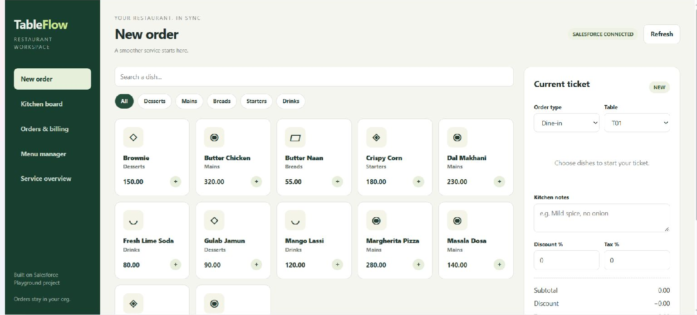
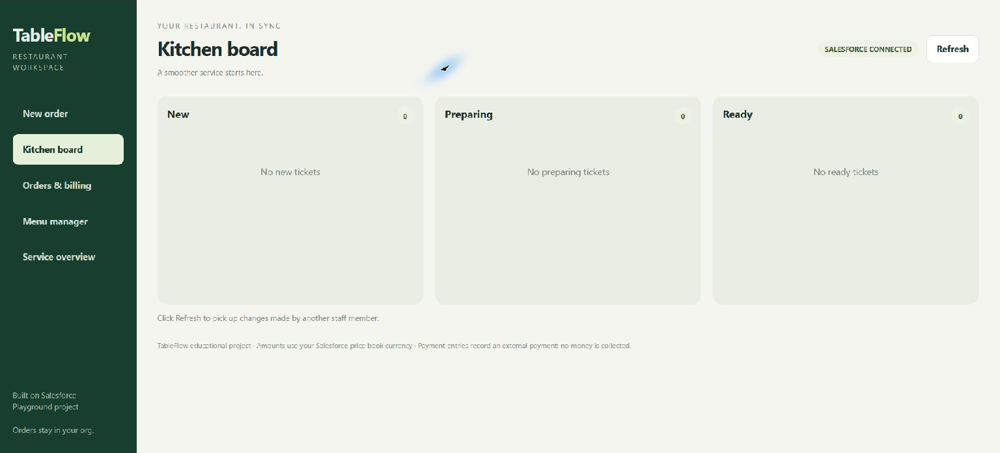
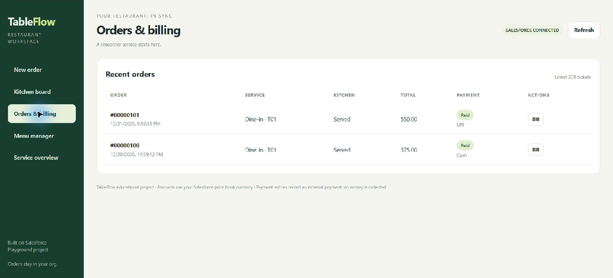
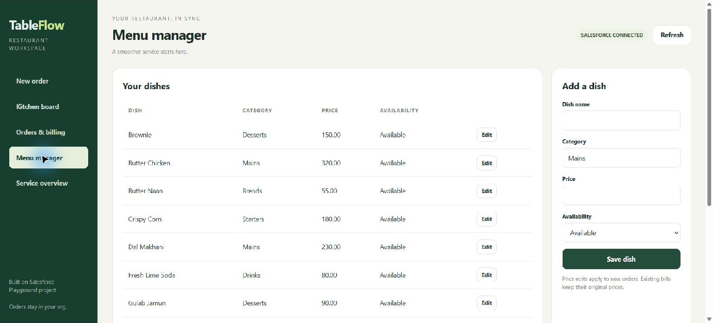

# TableFlow

Restaurant order management on Salesforce, built with Visualforce and Apex.

TableFlow brings order entry, kitchen tracking, billing, menu maintenance, and service reporting into one workspace. It runs inside a Salesforce org and uses standard Salesforce records.



## Features

- **New order:** search dishes, filter categories, adjust quantities, choose dine-in, takeaway or delivery, and add table details and kitchen notes.
- **Kitchen board:** move tickets through New, Preparing, Ready and Served.
- **Orders and billing:** review recent tickets, open printable receipts and record Cash, Card or UPI payments made externally.
- **Menu manager:** add and edit dishes, categories, prices and availability.
- **Service overview:** view recorded revenue, recent orders, unpaid tickets, popular dishes and table occupancy.
- **Historical prices:** order lines preserve the price charged when the ticket was created.

## Stack

Visualforce, HTML, CSS, JavaScript, Apex, SOQL and Salesforce standard objects. Browser interactions call `TableFlowController.invoke` through Visualforce JavaScript remoting. Server queries and writes use user-mode operations, and the controller declares `with sharing`.

## Data model

| Salesforce record | Purpose |
| --- | --- |
| `Product2` | Dish name, category in Description, availability in IsActive; product codes begin with `TF-` |
| `Pricebook2` and `PricebookEntry` | Standard price book and current dish prices |
| `Account` | Synthetic restaurant counter account |
| `Order` | Restaurant ticket; Salesforce Status remains Draft |
| `OrderItem` | Quantity and saved unit price for each dish |
| `Order.Description` | JSON containing service, table, notes, kitchen stage, payment state and adjustments |

Tables T01–T12 are interface choices rather than separate custom objects. Kitchen stages are separate from Salesforce Order.Status. The overview and order history use the latest 200 tickets.

## Getting started

Use a disposable Salesforce Developer Edition or Trailhead Playground. The seed action creates sample products and prices and activates the Standard Price Book if needed.

1. Clone this repository and open it as a Salesforce DX project.
2. Install Salesforce CLI and authenticate to your development org:

   ```sh
   sf org login web --alias tableflow-dev --set-default
   ```

3. Confirm that the org supports the API version declared in `sfdx-project.json` and the metadata files. Ensure Orders and the required standard objects are available.
4. Deploy the metadata:

   ```sh
   sf project deploy start --manifest manifest/package.xml --target-org tableflow-dev
   ```

5. Give intended users access to the Visualforce page and Apex class, and the necessary permissions for Account, Order, OrderItem, Product2, Pricebook2 and PricebookEntry. User-mode operations respect the user's permissions.
6. Open the page in the authenticated org:

   ```sh
   sf org open --target-org tableflow-dev --path /apex/TableFlow
   ```

7. If the menu is empty, use the sample-menu action. It creates 12 example dishes. Then build a ticket, follow it through the kitchen board, and inspect its bill.

The CLI deployment sequence is provided as setup guidance; deployment into a fresh org has not yet been verified. Existing org validation rules and permissions can require additional configuration.

## Project structure

```text
force-app/main/default/
  classes/TableFlowController.cls
  classes/TableFlowController.cls-meta.xml
  pages/TableFlow.page
  pages/TableFlow.page-meta.xml
manifest/package.xml
docs/screenshots/
sfdx-project.json
```

## Calculations and safeguards

The server retrieves current prices when creating a ticket. Discount is applied to the subtotal, then tax is calculated on the discounted amount. Adjustments are rounded to two decimal places. Ticket lines retain their saved unit prices when menu prices change.

The controller validates quantities, percentages, item availability and permitted kitchen transitions. Savepoint rollback protects failed operations. A draft token helps prevent sequential duplicate submissions, while kitchen updates lock the relevant order. This is not a guarantee against every concurrent duplicate-creation scenario.

## Screenshots

### Kitchen board


### Orders and billing


### Menu manager


## Status and limitations

This is an educational prototype. Existing-org checks documented order persistence, kitchen progression to Served, recording an external payment, receipt display and service summary updates. There is no automated Apex test suite or measured coverage included. Fresh-org deployment, menu-edit regression tests and browser print/export still need verification.

- Requires Salesforce; it is not a standalone desktop application.
- Payment entries record external payments; no money is collected.
- Other staff changes are retrieved with Refresh, rather than live push updates.
- Service metadata stored in JSON is convenient for the prototype but limits native field reporting and validation.
- Table occupancy is informational; it is not a reservation or exclusive table-booking system.
- Authentication expiry may require relaunching the org and reopening the page.

Potential extensions include automated tests, pagination, typed service fields, improved session recovery and automatic kitchen updates.
